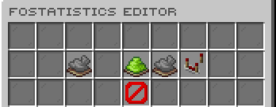

# FoStatistics

[](https://modrinth.com/plugin/fostatistics) [](https://modrinth.com/plugin/fostatistics/versions) [](https://discord.gg/kEF77QCfu7)

Safe in-game viewing and editing of Minecraft player statistics.

*Developed by Carrotio.*

## Features

- Reads and edits Minecraft statistics through the server API.
- Supports set, add, take, view, and editor workflows.
- Handles typed block, item, entity, and time-played statistics.
- Supports configurable limits and offline-player behavior.
- Keeps messages, sounds, and file logging configurable.

## Download and dependencies

Download the latest compatible version from [Modrinth](https://modrinth.com/plugin/fostatistics). Check the [versions page](https://modrinth.com/plugin/fostatistics/versions) for supported Minecraft versions and server platforms.

- **Required:** None
- **Optional integrations:** None

## Screenshots



*Browse and edit player statistics.*

## Support

For help or issue reports, join the [Carrotio Discord server](https://discord.gg/kEF77QCfu7).

<details>
<summary><strong>Commands and permissions</strong></summary>

### Commands

- `/fostatisticsadmin <help|view|set|add|take|editor>` — FoStatistics admin command. Aliases: `/statisticsadmin`.

### Permissions

- `fostatistics.admin` — Allows FoStatistics admin commands. Default: `op`.

</details>

<details>
<summary><strong>PlaceholderAPI</strong></summary>

This plugin does not register public PlaceholderAPI placeholders.

</details>

<details>
<summary><strong>Configuration</strong></summary>

- `config.yml` — Main behavior and feature settings.
- `messages.yml` — Player-facing messages and interface text.
- `sounds.yml` — Configurable interaction sounds.

Main config areas: `statistics`, `file-logging`.

</details>

<details>
<summary><strong>Developer API</strong></summary>

FoStatistics registers `FoStatisticsService` with Bukkit's `ServicesManager` after startup. It accepts synchronous `SET`, `ADD`, and `TAKE` edits under the same amount and offline-player rules as the admin command. An API caller must be an enabled plugin. The amount is a non-negative raw statistic value; `PLAY_ONE_MINUTE` uses ticks. A returned `CHANGED` means Bukkit accepted the new value, while `UNCHANGED` means no setter or event was used. Other result statuses explain rejected requests. Bukkit controls when player statistics reach disk.

Build this project with `mvn clean package`, install `target/FoStatistics-1.7.jar` in your local Maven repository if needed, and compile your consumer against it as `provided` (Gradle: `compileOnly`). Do not shade FoStatistics into the consumer. The Maven coordinates for a locally installed jar are `me.foesio:FoStatistics:1.7`; this does not imply a published Maven repository. The server must run a FoStatistics jar containing this API, even if an older jar has the same version number.

```sh
mvn install:install-file -Dfile=target/FoStatistics-1.7.jar -DgroupId=me.foesio -DartifactId=FoStatistics -Dversion=1.7 -Dpackaging=jar
```

```xml
<dependency>
    <groupId>me.foesio</groupId>
    <artifactId>FoStatistics</artifactId>
    <version>1.7</version>
    <scope>provided</scope>
</dependency>
```

Add `depend: [FoStatistics]` to your `plugin.yml`, or `softdepend: [FoStatistics]` if the integration is optional. For an optional integration, load code that references FoStatistics classes only after checking that FoStatistics is enabled. Reacquire the service after a provider reload; do not keep and use a disabled provider instance.

```java
FoStatisticsService service = Bukkit.getServicesManager().load(FoStatisticsService.class);
if (service != null) {
    StatisticEditResult result = service.edit(this, player,
            StatisticTarget.of(Statistic.JUMP), StatisticEditAction.ADD, 1);
    if (result.status() == StatisticEditResult.Status.CHANGED) {
        // The Bukkit statistic was changed.
    }
}
```

`FoStatisticEditedEvent` fires synchronously after a value-changing FoStatistics command or service edit. It is not cancellable. It contains the player's UUID, typed statistic target, action, previous/new values, origin (`COMMAND` or `API`), and source name. `getActorId()` is the admin player's UUID for player commands and is null for console or API calls. Failed and unchanged edits fire no event. Direct Bukkit writes and ordinary gameplay changes are outside this event's scope; use Bukkit's statistic event where appropriate. Listeners run in the same primary-thread call and may inspect Bukkit player state. The service returns `WRONG_THREAD` for calls made off the primary thread; schedule those calls on the server thread. This plugin does not declare Folia support.

Register the listener through Bukkit's plugin manager during your plugin's enable step.

```java
@EventHandler
public void onStatisticEdited(FoStatisticEditedEvent event) {
    UUID playerId = event.getPlayerId();
    int newValue = event.getNewValue();
    // Refresh your own progress for playerId.
}
```

</details>
